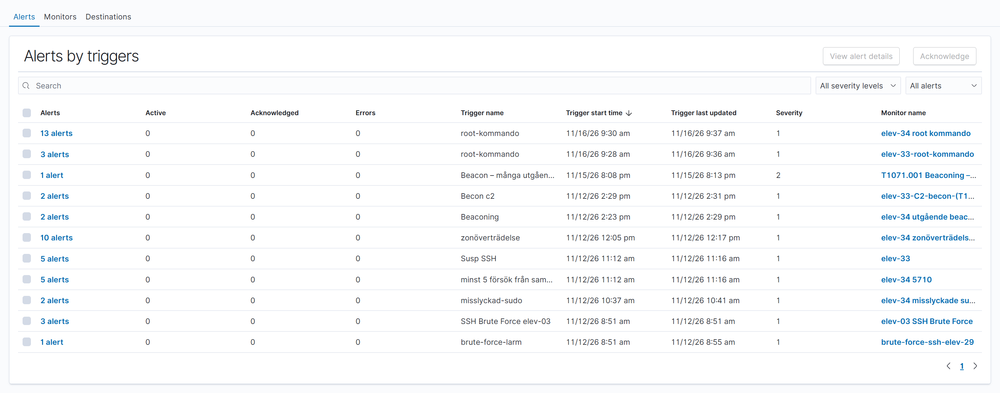
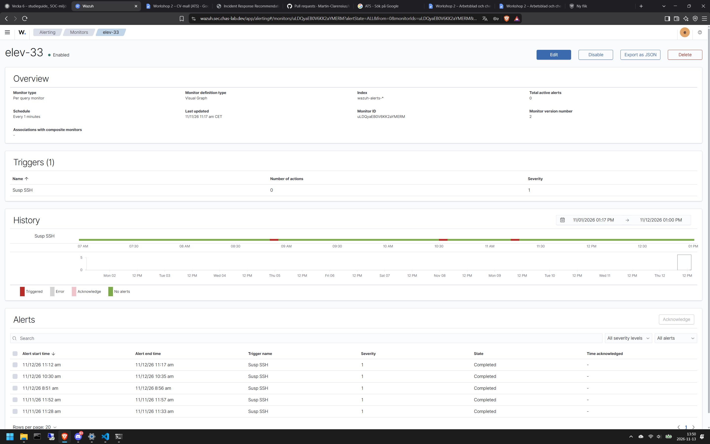
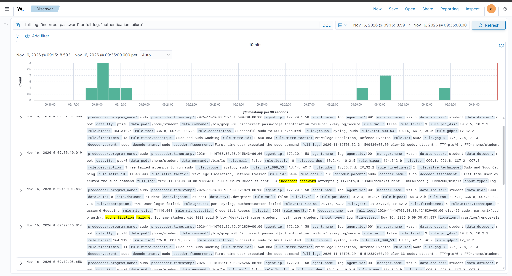
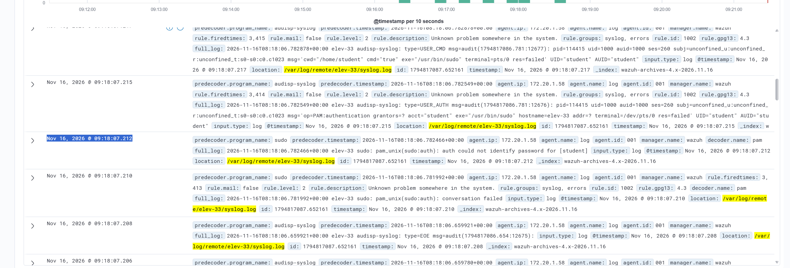
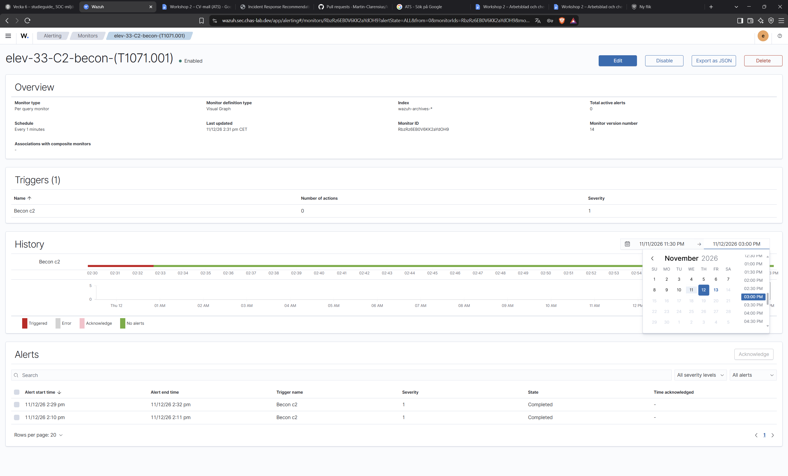

# Detektioner och playbooks – milstolpe 6

**Kurs:** ITSX26 – Kurs 2, vecka 6
**Team:** Ankorna
**Ansvarig:** elev-33 (Per Palmgren)
**Loggplattform:** Wazuh (https://wazuh.sec.chas-lab.dev), OpenSearch Alerting-monitorer

> Fält markerade med ⟨…⟩ fylls i med värden från min egen miljö. Inga siffror i dokumentet är uppskattade.

## Status

| Detektion | Larmar | Brus normaltrafik | Brus mitt fönster | Playbook |
|---|---|---|---|---|
| D1 SSH brute force | ✅ 2026-11-12 11:12 | ⟨n⟩ | ⟨n⟩ | ✅ |
| D2 Zonöverträdelse (nftables) | ⟨✅ hh:mm⟩ | ⟨n⟩ | ⟨n⟩ | ✅ |
| D3 Root-kommando (auditd) | ✅ 2026-11-16 09:28 (3 larm t.o.m. 09:36) | ⟨n⟩ | ⟨n⟩ | ✅ |
| D4 Misslyckad sudo | ❌ Larmade inte på testet 2026-11-16 09:18 – felsöks | ⟨n⟩ | ⟨n⟩ | ✅ |

| D5 Beaconing (VG, U6.5) | ✅ 2026-11-12 14:29 | ⟨n⟩ | ⟨n⟩ | ✅ |

---

## Gemensamt för alla detektioner

| Sak | Värde |
|---|---|
| Index för larm | `wazuh-alerts-*` |
| Index för alla händelser | `wazuh-archives-*` (även poster som ingen standardregel larmar på) |
| Hur min server känns igen | `location` innehåller `elev-33`. Alla poster har `agent.name: log` eftersom loggservern läser in dem, så `agent.name` går inte att filtrera på. |
| Filter i monitorer | `location contains elev-33`. **Inte** `location is *elev-33*`: `is` kräver exakt match och stjärnorna tolkas bokstavligt (teamets lärdom från Martins D1). |
| Hur loggarna når loggservern | rsyslog → TLS tcp 6514 till `log.sec.chas-lab.dev` (`90-tls-forward.conf`, regeln för 6514 laddad i nftables), kärnloggen även tcp 514 till 172.20.1.58 (`60-brandvagg.conf`) |
| Monitorer | Alla byggda i Wazuh (Alerting → Monitors). ⟨Skärmdumpar återstår.⟩ |
| Tidszon | elev-33 går på ⟨UTC, kontrollera med `timedatectl`⟩. Dashboarden visar svensk tid (CET = UTC+1). Alla larmtider nedan är svensk tid om inte UTC anges. |
| Normaltrafikperiod (utbildarens, enligt `kontrollera U6.3`) | ⟨2026-11-11 08:06–08:37 svensk tid = 31 min ≈ 0,52 h – bekräfta⟩ |
| Mitt mätfönster | ⟨start – slut = x h⟩ |
| Kända legitima källor | jump-servern 172.20.1.2 (egna inloggningar, flöde D1), ctf-servern 172.20.1.10 (CTF-kontroller, loggar in som root med nyckel, flöde D2) |

**Faser i playbookarna (NIST SP 800-61):**
1. Förberedelse
2. Detektion och analys
3. Inneslutning, utrotning och återställning
4. Efterarbete (lärdomar)

**Triagens tre frågor (gäller alla larm):** Vad har hänt? Vad har berörts? Vad ska göras?
Observationer och slutsatser hålls i olika fält i [triageloggen](triagelogg.md).

---

## D1 – SSH brute force

### Nedbrytning

| Del | Innehåll |
|---|---|
| Händelse | Upprepade misslyckade SSH-inloggningar från samma källadress |
| Loggkälla | Autentiseringsloggen (`/var/log/secure`, sshd; på Rocky Linux 9 programnamnet `sshd-session`) |
| Fält | `rule.id`, `rule.level`, `data.srcip`, `data.srcuser`, `predecoder.program_name`, `location`, `timestamp` |
| Wazuh-regler | `5710` försök med användare som inte finns, `5712` brute force mot användare som inte finns, `5716`/`5720` misslyckad autentisering mot befintlig användare, `40112` flera misslyckanden följt av lyckad inloggning |
| Faktiska värden | ⟨`data.srcip`, exempel på `data.srcuser`, `rule.level` från mina egna poster efter U6.2⟩ |
| Gränsfall som inte ska träffa | En enstaka felskrivning vid egen inloggning från jump (172.20.1.2): ett misslyckande följt av lyckad inloggning ger högst en post, under tröskeln |
| ATT&CK | T1110 Brute Force (T1110.001 Password Guessing) |

### Detektion

| Del | Innehåll |
|---|---|
| Monitornamn | `elev-33` (trigger `Susp SSH`) |
| Monitor-ID / version | `uLDQyaEB0V6KK2aYMERM`, version 2 (senast ändrad 2026-11-11 11:17 CET) |
| Typ | Per query monitor, Visual Graph |
| Index | `wazuh-alerts-*` |
| Fråga | COUNT OF `rule.id`, senaste ⟨5⟩ min, filter `rule.id is 5710` och `location contains elev-33` |
| Trigger | `Susp SSH`: IS ABOVE 4 (minst 5 försök inom fönstret), severity 1 |
| Körintervall | 1 minut |
| Varför 5710 | Regel 5710 ("Attempt to login using a non-existent user") ger en post per försök. Teamets erfarenhet (Martin) är att 5712 inte gick vid U6.2. |
| Brus i normaltrafik, utan location-filter | ⟨n träffar på 0,52 h ≈ n/h⟩ |
| Brus i normaltrafik, med monitorns filter | ⟨n⟩ |
| Brus i mitt mätfönster | ⟨n träffar på x h = n/h⟩ |
| Falsklarmrisk | ⟨Låg/medel/hög + motivering⟩. Kända källor som ger larm: CTF-kontrollen U6.2 (172.20.1.10). |
| Känd lucka (falskt negativt) | Monitorn tittar bara på 5710, alltså användare som *inte finns*. Gissning mot konton som finns ger 5716/5720 och fångas inte. Långsam gissning under tröskeln fångas inte heller. ⟨Beslut: lägg till 5716/5720 eller dokumentera luckan⟩ |

### Verifiering

| Del | Innehåll |
|---|---|
| Hur händelsen framkallades | `kontrollera U6.2 start` i ssh jump (genomfört) |
| Tid då händelsen framkallades | ⟨yyyy-mm-dd hh:mm:ss UTC (hh:mm:ss svensk tid) – läs av i terminalen eller i Discover⟩ |
| Poster i Discover | ⟨n poster med regel 5710 från ⟨srcip⟩ kl. ⟨…⟩⟩ |
| Larmhistorik (alla Completed, severity 1) | 2026-11-11 11:28–11:33, 11:52–11:57; 2026-11-12 08:51–08:56, 10:30–10:35, **11:12–11:17** |
| Mitt larm (U6.2) | **2026-11-12 11:12–11:16 svensk tid** |
| Övriga larm i historiken | 11/11 11:28, 11:52 och 12/11 08:51, 10:30 kommer inte från mina egna tester. Teamet utgår från samma testserver (ctf-servern 172.20.1.10) i scenariot, och larmen sammanfaller med teamets andra U6.2-körningar (t.ex. elev-34). De räknas som förväntade testlarm, inte som angrepp. |
| Bevis | [`skärmdumpar/d1-monitor-larm.png`](skärmdumpar/d1-monitor-larm.png) (monitor, trigger och larmhistorik), ⟨`d1-discover-u62.png`, `d1-normaltrafik.png`⟩ |

### Playbook D1

**1. Förberedelse**
- Kontrollera att monitorn `elev-33` (trigger `Susp SSH`) är Enabled.
- Ha listan med kända källor till hands (jump 172.20.1.2, ctf 172.20.1.10).
- Se till att du har åtkomst till Wazuh och SSH till elev-33 via jump.

**2. Detektion och analys**
1. Öppna larmet under Alerting → Alerts och anteckna starttiden. *(observation)*
2. Discover → `wazuh-alerts-*`, ±15 min runt larmet: `location: *elev-33* and rule.id: (5710 or 5712 or 5716 or 5720)`.
3. **Vad har hänt?** Notera `data.srcip`, antal försök, tidsspann och vilka användarnamn som provats. *(observationer)*
4. Är källan känd? Jämför med listan över kända källor och, för ctf-servern, med tiden för `kontrollera`-körningen.
5. **Vad har berörts?** Sök efter lyckad inloggning från samma källa: `data.srcip: <källa> and rule.id: (5715 or 40112)`. Om det finns en: vilket konto och vilken metod (lösenord eller `publickey`)?
6. En nyckelinloggning som root från ctf-servern direkt efter U6.2 är CTF-kontrollen, inte en lyckad gissning.
7. Upprepa sökningen utan `location`-filter: berörs andra servrar i teamet?
8. **Vad ska göras? Beslut:**
   - *Avfärda:* bara med granskbart skäl, t.ex. "källa 172.20.1.10, tiden stämmer med `kontrollera U6.2 start` kl. hh:mm, ingen lyckad lösenordsinloggning". "Det var nog jag" räcker inte.
   - *Eskalera:* okänd källa, flera konton/servrar berörda, eller lyckad inloggning efter försöken.

**3. Inneslutning, utrotning och återställning** (endast vid eskalering)
- Blockera källan i båda lagren. I nftables släpper kedjan `in` bara SSH från 172.20.1.2 (D1) och 172.20.1.10 (D2); allt annat stoppas av `policy drop`. Gäller attacken en tillåten källa: begränsa den regeln och kontrollera att molnbrandväggen `itsx26-elev-33` inte släpper in källan.
- Vid lyckad inloggning: lås kontot (`sudo usermod -L <konto>`), avsluta sessionen och granska vad kontot gjort (D3).
- Kontrollera `PasswordAuthentication` och `PermitRootLogin` i `sshd_config`.
- Verifiera att legitim inloggning från jump fortfarande fungerar.

**4. Efterarbete**
- Skriv en post i triageloggen med observation och slutsats i skilda fält.
- Om larmet var brus: justera tröskel eller undantag och mät bruset igen.
- Ny legitim källa: lägg till den i listan över kända källor.

---

## D2 – Zonöverträdelse (paketfiltrets logg)

### Nedbrytning

| Del | Innehåll |
|---|---|
| Händelse | Trafik som flödestabellen inte tillåter och som nftables därför stoppar och loggar |
| Loggkälla | Kärnloggen från nftables, tabell `inet zon`. Kedja `ut` (hook output, policy drop) loggar med prefix `ZON-UT-DROP `; kedja `in` (hook input, policy drop) med `ZON-IN-DROP `. Båda `limit rate 10/minute burst 5 packets ... level info`. Skickas via rsyslog (`kern.*` till 172.20.1.58:514 och allt via TLS 6514). |
| Fält | `full_log` (prefix samt `SRC=`, `DST=`, `PROTO=`, `DPT=`), `location`, `timestamp` |
| Faktiska värden | ⟨kontrollera prefixet med `sudo nft list ruleset` i ssh lab – i `zon.nft` står `ZONE-UT-DROP` utan mellanslag, i `nft-backup.nft` `ZON-UT-DROP ` med⟩; testflöde ⟨`DST=1.1.1.1`, `DPT=8080`⟩ |
| Gränsfall som inte ska träffa | Tillåtna flöden D1–D7 enligt flödestabellen (t.ex. dnf på tcp 443 ut, D7) |

### Detektion

| Del | Innehåll |
|---|---|
| Monitornamn | `elev-33 zonöverträdelse` |
| Typ | Per query monitor, Extraction Query |
| Index | `wazuh-archives-*` (ingen standardregel larmar på posten) |
| Fråga | `full_log` match_phrase `ZON-UT-DROP` ⟨eller faktiskt prefix⟩ och `location` innehåller `elev-33`, senaste 5 min |
| Trigger | `zonöverträdelse`: `ctx.results[0].hits.total.value > 0` |
| Körintervall | 1 minut |
| Brus i normaltrafik | ⟨n⟩ |
| Brus i mitt mätfönster | ⟨n på x h⟩. Väntat lågt, eftersom D7 (tcp 443 ut på eth0) är öppen hos mig. Martin fick 136 träffar/15,5 h från dnf när D7 saknades i nftables. |
| Falsklarmrisk | ⟨…⟩. Legitima flöden som saknas i flödestabellen ger larm. Undantag görs genom att flödet läggs in i flödestabellen, inte genom att monitorn breddas. |
| Känd lucka | Loggregeln är rate-limiterad (10/min), så antalet poster är en lägre gräns. Trafik som går via ett tillåtet flöde (t.ex. tcp 443 ut) loggas inte alls – se D5. |

### Verifiering

| Del | Innehåll |
|---|---|
| Hur händelsen framkallades | `timeout 3 bash -c 'echo > /dev/tcp/1.1.1.1/8080'; date` i ssh lab |
| Tid enligt `date` | ⟨… UTC⟩ |
| Larmets starttid | ⟨hh:mm svensk tid⟩ |
| Bevis | `skärmdumpar/d2-monitor-larm.png`, `skärmdumpar/d2-test-terminal.png`, `skärmdumpar/d2-normaltrafik.png` |

### Playbook D2

**1. Förberedelse**
- Kontrollera att monitorn är Enabled.
- Ha flödestabellen (vecka 3/4) öppen. Den avgör vad som är tillåtet.

**2. Detektion och analys**
1. Anteckna larmets starttid.
2. Discover → `wazuh-archives-*`, ±15 min: `location: *elev-33* and full_log: "ZON-UT-DROP"`.
3. **Vad har hänt?** Läs `SRC`, `DST`, `PROTO`, `DPT` ur `full_log`; antal poster och tidsspann. *(observationer)*
4. Finns flödet i flödestabellen? Är målet ett känt legitimt mål som saknas där?
5. **Vad har berörts?** Trafiken stoppades redan, så frågan är *vilken process* som försökte. Logga in på elev-33 och leta: `ss -tunap`, `journalctl --since "<tid>"`.
6. Upprepas försöken med jämna mellanrum? Då kan det vara ett program som ringer hem (se D5).
7. **Beslut:**
   - *Avfärda:* eget test med `date`-tid som stämmer, eller legitimt flöde som saknas i tabellen (skapa ändringsärende för flödestabellen).
   - *Eskalera:* okänd process eller okänt mål, eller upprepade försök.

**3. Inneslutning, utrotning och återställning**
- Flödet är redan stoppat av kedjan `ut`. Kontrollera att molnbrandväggen `itsx26-elev-33` inte heller släpper ut det.
- Okänd process: stoppa den, ta reda på hur den startas (tjänst, cron, användare) och ta bort den.

**4. Efterarbete**
- Skriv en post i triageloggen.
- Legitimt flöde: uppdatera flödestabellen, `zon.nft` och testfallen i `brandvägg/testfall/`, och mät bruset igen.

---

## D3 – Kommando som körs som root (auditd)

### Nedbrytning

| Del | Innehåll |
|---|---|
| Händelse | Kommando som körs med root-rättigheter av en inloggad användare |
| Loggkälla | auditd, regel med nyckeln `root_cmd` (vecka 5, se [loggning.md](../loggning.md)), vidare via audisp-syslog → rsyslog → TLS |
| Fält | `full_log`, `location`, `timestamp` |
| Faktiska värden | Nyckel `root_cmd`, `auid=⟨1000⟩` (= ⟨konto⟩ enligt `getent passwd 1000`). Exempelrad från vecka 5: `type=EXECVE ... a0="sudo" a1="/usr/bin/touch" a2="/tmp/sparc6e7feb6"` |
| Gränsfall som inte ska träffa | Root-processer som inte startats av en inloggad användare (dnf, cron, systemd) – de har `auid=4294967295` (unset) |
| Känd lucka (falskt negativt) | Direkt root-inloggning (t.ex. ctf-serverns kontroller med nyckel) har inte auid 1000 och fångas inte om frågan kräver `auid=1000`. |

### Detektion

| Del | Innehåll |
|---|---|
| Monitornamn | `elev-33-root-kommando` (byggd, se [`monitorer-oversikt.png`](skärmdumpar/monitorer-oversikt.png)) |
| Typ | Per query monitor, Extraction Query |
| Index | `wazuh-archives-*` |
| Fråga | Senaste 5 min, `match_phrase` på `full_log`, alla måste träffa: `elev-33 audisp-syslog`, `type=SYSCALL`, `root_cmd`, `auid=1000` |
| Trigger | `root-kommando`: `ctx.results[0].hits.total.value > 0`, severity 1 |
| Körintervall | 1 minut |
| Brus i normaltrafik | ⟨n⟩ |
| Brus i mitt mätfönster | ⟨n på x h⟩ |
| Falsklarmrisk | Låg utanför arbetstid. Teamets eget arbete med sudo dagtid ger larm. |

### Verifiering

| Del | Innehåll |
|---|---|
| Hur händelsen framkallades | Lyckad sudo som `student`: `sudo grep -iE 'incorrect password\|authentication failure' /var/log/secure` |
| Tid | 2026-11-16 08:29:15 UTC (09:29:15 svensk tid), enligt `/var/log/secure`: `sudo[114428]: student : TTY=pts/0 ; PWD=/home/student ; USER=root ; COMMAND=/bin/grep ...` |
| Poster i Discover | ⟨auditd-post med `root_cmd` ca 09:29:15⟩ |
| Larm | `elev-33-root-kommando`, trigger `root-kommando`: 3 larm, start 2026-11-16 09:28, senast uppdaterat 09:36 svensk tid ([`alerts-oversikt.png`](skärmdumpar/alerts-oversikt.png)) |
| Bevis | `skärmdumpar/d3-larm.png`, `skärmdumpar/d3-normaltrafik.png` |

### Playbook D3

**1. Förberedelse**
- Kontrollera att monitorn är Enabled.
- Kontrollera att auditd-regeln finns: `sudo auditctl -l` i ssh lab ska visa `-k root_cmd`.
- Ha en lista över vilka som får använda sudo på elev-33 och när planerat arbete pågår.

**2. Detektion och analys**
1. Anteckna larmets starttid. *(observation)*
2. Discover → `wazuh-archives-*`, ±15 min: `location: *elev-33* and full_log: "root_cmd"`.
3. **Vad har hänt?** Läs `exe`/`comm` (vilket program), `auid` (vem som loggade in) och `uid` (vem kommandot kördes som). *(observationer)*
4. **Vem var det?** `getent passwd <auid>` i ssh lab. Lokalt: `sudo ausearch -k root_cmd -ts recent -i`.
5. Var det planerat? Jämför med teamets pågående arbete och ändringar.
6. **Vad har berörts?** Vilka filer, tjänster eller konton ändrades?
7. **Beslut:**
   - *Avfärda:* granskbart skäl, t.ex. "`sudo id` kört av student i ssh lab kl. hh:mm:ss, eget test".
   - *Eskalera:* okänt kommando, okänt konto, utanför arbetstid eller ändringar ingen i teamet känner till.

**3. Inneslutning, utrotning och återställning** (endast vid eskalering)
- Lås kontot (`sudo usermod -L <konto>`) och avsluta dess sessioner.
- Ta bort kontots sudo-rätt tills saken är utredd.
- Återställ det kommandot ändrade (filer, tjänster, nya konton, cron).

**4. Efterarbete**
- Skriv en post i triageloggen.
- Återkommande legitima root-kommandon: lägg in som undantag och mät bruset igen.

---

## D4 – Misslyckad sudo (teamets egen händelse)

### Nedbrytning

| Del | Innehåll |
|---|---|
| Händelse | Felaktigt lösenord till sudo |
| Loggkälla | Autentiseringsloggen (PAM, `/var/log/secure`) |
| Fält | `full_log`, `location`, `rule.id`, `data.srcuser`, `data.uid`, `data.euid`, `data.tty` |
| Wazuh-regel | `5503` "PAM: User login failed." (nivå 5, Wazuh märker den med T1110.001) ⟨bekräfta i min post⟩ |
| Exempel från `/var/log/secure` (UTC) | `Nov 16 08:17:58 elev-33 sudo[114409]: pam_unix(sudo:auth): authentication failure; logname=student uid=1000 euid=0 tty=/dev/pts/0 ruser=student rhost=  user=student` följt av `student : 1 incorrect password attempt ; TTY=pts/0 ; PWD=/home/student ; USER=root ; COMMAND=/bin/true` |
| Gränsfall som inte ska träffa | Lyckad sudo (verifieras i testet) |

### Detektion

| Del | Innehåll |
|---|---|
| Monitornamn | `Misslyckad-sudo-elev-33` (byggd, se [`monitorer-oversikt.png`](skärmdumpar/monitorer-oversikt.png)) |
| Typ | Per query monitor, Extraction Query |
| Index | `wazuh-archives-*` |
| Fråga | Senaste 5 min, `full_log` innehåller `pam_unix(sudo:auth): authentication failure` och `elev-33` |
| Trigger | `misslyckad-sudo`: `ctx.results[0].hits.total.value > 0` |
| Körintervall | 1 minut |
| Brus i normaltrafik | ⟨n⟩ |
| Brus i mitt mätfönster | ⟨n på x h⟩ |
| Falsklarmrisk | Låg. Ett larm betyder normalt att någon skrivit fel lösenord till sudo. Om felskrivningar ger för många larm: höj tröskeln (t.ex. > 2 på 5 min). |

### Verifiering

| Del | Innehåll |
|---|---|
| Hur händelsen framkallades | `echo fel \| sudo -S -k true` i ssh lab, två gånger |
| Tid (lokal logg, UTC) | 2026-11-16 08:17:58 (`sudo[114409]`) och 08:18:04 (`sudo[114415]`) = 09:17:58 och 09:18:04 svensk tid. Båda med `authentication failure` och `1 incorrect password attempt`. |
| Larm | **Inget larm** från `Misslyckad-sudo-elev-33` för testet 09:18 ([`alerts-oversikt.png`](skärmdumpar/alerts-oversikt.png)). Trolig orsak: posterna i `wazuh-archives-*` innehåller `conversation failed` och `auth could not identify password`, inte `authentication failure` som står i `/var/log/secure`. ⟨Jämför monitorns fråga med posterna, rätta och testa igen.⟩ |
| Poster i Discover | 09:18:07.208–09:18:07.217 svensk tid, alla `location: /var/log/remote/elev-33/syslog.log`: `sudo: pam_unix(sudo:auth): conversation failed`, `sudo: pam_unix(sudo:auth): auth could not identify password for [student]`, auditd `type=USER_AUTH ... op=PAM:authentication ... exe="/usr/bin/sudo" ... res=failed AUID="student"` och `type=USER_CMD ... cmd="true" exe="/usr/bin/sudo" ... res=failed`. Sökningen `full_log: "incorrect password" or full_log: "authentication failure"` 09:15–09:35 gav 10 träffar. |
| Fynd 1: frasen träffar lyckade kommandon | Två av träffarna (09:29:15 och 09:32:31) är **lyckade** `sudo grep -iE 'incorrect password\|authentication failure' /var/log/secure` (regel 5402 "Successful sudo to ROOT executed"). Frasen finns i själva kommandoraden. En monitor som bara söker på frasen ger alltså falsklarm när någon söker i loggen. Frågan bör kräva `pam_unix(sudo:auth)` eller utesluta `COMMAND=`. |
| Fynd 2: andra servrar | Träffarna 09:30:01 och 09:30:10 kommer från **elev-29** (regel 5503 "PAM: User login failed" och 5404 "Three failed attempts to run sudo"). Utan filter på `elev-33` hade monitorn larmat på en annan elevs test. |
| Bevis | [`d4-discover.png`](skärmdumpar/d4-discover.png), [`d4-poster-0918.png`](skärmdumpar/d4-poster-0918.png) |
| Larm | ⟨hh:mm svensk tid⟩ |
| Gränsfall | Lyckad sudo 08:29:15 UTC (09:29:15 svensk tid) ⟨gav inget D4-larm – bekräfta⟩ |
| Bevis | Se raden Bevis ovan. ⟨`d4-monitor-larm.png`: monitorns larmhistorik⟩ |

### Playbook D4

**1. Förberedelse**
- Kontrollera att monitorn är Enabled.
- Ha en lista över vilka konton som har sudo-rätt på elev-33.

**2. Detektion och analys**
1. Anteckna larmets starttid. *(observation)*
2. Discover → `wazuh-archives-*`, ±15 min: `location: *elev-33* and full_log: "authentication failure" and full_log: "sudo"`.
3. **Vad har hänt?** Vilket konto (`user=`/`ruser=`), vilken terminal (`tty=`), hur många misslyckanden på hur lång tid. *(observationer)*
4. Följdes misslyckandet av lyckad sudo från samma konto? `location: *elev-33* and full_log: "sudo" and full_log: "COMMAND"`.
5. **Vad har berörts?** Vilken session (inloggning från vilken adress, se D1-sökningen) och om sudo till slut lyckades.
6. **Beslut:**
   - *Avfärda:* enstaka felskrivning av känt konto följd av lyckad sudo i samma session, med skälet utskrivet.
   - *Eskalera:* upprepade misslyckanden utan lyckad sudo, okänt konto eller okänd session – kan vara någon som gissar lösenord efter att ha tagit sig in.

**3. Inneslutning, utrotning och återställning** (endast vid eskalering)
- Avsluta sessionen och lås kontot (`sudo usermod -L <konto>`).
- Byt kontots lösenord och utred hur sessionen kom in (D1).

**4. Efterarbete**
- Skriv en post i triageloggen.
- Vid återkommande felskrivningar: inför tröskel och mät bruset igen.

---

## D5 – Periodisk utgående beaconing (U6.5, frivillig VG-uppgift)

> Fyll bara i om U6.5 genomförs.

### Nedbrytning

| Del | Innehåll |
|---|---|
| Händelse | Ett program på servern kontaktar samma externa adress med jämna mellanrum |
| Loggkälla | Programmets egen logg via syslog, i `wazuh-archives-*` (ingen standardregel larmar) |
| Fält | `predecoder.program_name`, `full_log`, `location`, `timestamp` |
| Faktiska värden | ⟨program, konto, mål-URL, intervall från mina egna poster⟩ |
| Gränsfall som inte ska träffa | Enstaka anrop (färre än 5 på 5 min) |
| ATT&CK | T1071.001 Application Layer Protocol: Web Protocols (taktik Command and Control) |
| Varför D2 inte fångar detta | Trafiken går ut på tcp 443, som är öppen i min kedja `ut` (D7). Den loggas därför aldrig som zonöverträdelse – en lucka i mitt regelverk som D5 täcker. |

### Detektion

| Del | Innehåll |
|---|---|
| Monitornamn | `elev-33-C2-becon-(T1071.001)` (trigger `Becon c2`) |
| Monitor-ID / version | `RbzRz6EB0V6KK2aYdOH9`, version 14 (senast ändrad 2026-11-12 14:31 CET) |
| Typ | Per query monitor, Visual Graph |
| Index | `wazuh-archives-*`, senaste ⟨5⟩ min |
| Filter | `predecoder.program_name is syncagent` och `location contains elev-33` |
| Trigger | `Becon c2`: COUNT IS ABOVE 4 (minst 5 anrop inom fönstret), severity 1 |
| Körintervall | 1 minut |
| Brus | ⟨normaltrafik n, mitt fönster n⟩ |
| Känd lucka | Bunden till programnamnet; ett omdöpt program eller glesare anrop fångas inte. |

### Verifiering

| Del | Innehåll |
|---|---|
| Hur händelsen framkallades | `kontrollera U6.5 start` i ssh jump |
| Larmhistorik (Completed, severity 1) | 2026-11-12 14:10–14:11 och 14:29–14:32 svensk tid |
| Mitt larm (U6.5) | **2026-11-12 14:29–14:31 svensk tid** |
| Larmet 14:10 | Tidigare körning av U6.5, som jag inte själv framkallade. Larmet räknas som förväntat testlarm. |
| Bevis | [`skärmdumpar/d5-monitor-larm.png`](skärmdumpar/d5-monitor-larm.png), ⟨flaggan från `kontrollera U6.5`⟩ |

### Playbook D5 (kort)

1. **Förberedelse:** lista över godkända externa destinationer och tjänstekonton.
2. **Detektion och analys:** läs program, konto, mål och intervall i `full_log`. Är målet godkänt? Är programmet installerat av teamet?
3. **Inneslutning, utrotning och återställning:** okänt mål → stoppa processen, ta reda på hur den startas (tjänst/cron), spärra målet i kedjan `ut` och i molnbrandväggen.
4. **Efterarbete:** uppdatera listan över godkända mål, eller bredda regeln om den missade något.

---

## Regelverket på elev-33 (båda lagren)

Blockering i playbookarna görs i båda lagren.

**Lager 1 – nftables** (`sudo nft list ruleset` i ssh lab), tabell `inet zon` (se [`brandvägg/cfg/nft-backup.nft`](../brandvägg/cfg/nft-backup.nft)):

| Kedja | Policy | Tillåtet |
|---|---|---|
| `in` | drop | established/related, lo, SSH 22 från jump 172.20.1.2 (D1), SSH 22 från ctf 172.20.1.10 (D2), DHCP-svar udp 67→68 på eth0–eth2 (D6). Övrigt loggas `ZON-IN-DROP `. |
| `ut` | drop | established/related, lo, SSH 22 till Web/App/Data/Logg-zonerna (F6), DNS 53 till 185.12.64.1/.2 (D3), NTP udp 123 på eth0 (D4), DHCP-klient (D6), tcp 443 på eth0 (D7), syslog-TLS tcp 6514 till 172.20.1.58 (D5). Övrigt loggas `ZON-UT-DROP `. |

Loggkedjan till Wazuh går via TLS på tcp 6514 enligt [`brandvägg/cfg/90-tls-forward.conf`](../brandvägg/cfg/90-tls-forward.conf), som ersätter den tidigare `10-forward.conf`. Den okrypterade regeln för tcp 514 är borttagen ur nftables. All loggning, även kärnloggen, går via TLS på 6514.

**Lager 2 – molnplattformen** (`moln status` i ssh jump): ⟨molnbrandväggens regler för elev-33⟩

---

## Korstest av playbookarna

Varje playbook testas av en teammedlem som inte har skrivit den. Testaren får bara larmet och playbooken, och följer stegen utan hjälp från mig.

| Playbook | Testad av | Datum | Larm som användes | Kom testaren fram till rätt beslut? | Vad var oklart / förbättring | Ändrat efter testet |
|---|---|---|---|---|---|---|
| D1 SSH brute force | ⟨namn⟩ | ⟨datum⟩ | ⟨larm hh:mm⟩ | ⟨ja/nej⟩ | ⟨…⟩ | ⟨…⟩ |
| D3 Root-kommando | ⟨namn⟩ | ⟨datum⟩ | ⟨larm hh:mm⟩ | ⟨ja/nej⟩ | ⟨…⟩ | ⟨…⟩ |
| D4 Misslyckad sudo | ⟨namn⟩ | ⟨datum⟩ | ⟨larm hh:mm⟩ | ⟨ja/nej⟩ | ⟨…⟩ | ⟨…⟩ |
| D5 Beaconing | ⟨namn⟩ | ⟨datum⟩ | ⟨larm hh:mm⟩ | ⟨ja/nej⟩ | ⟨…⟩ | ⟨…⟩ |
| D2 Zonöverträdelse (om monitorn byggs) | ⟨namn⟩ | ⟨datum⟩ | ⟨larm hh:mm⟩ | ⟨ja/nej⟩ | ⟨…⟩ | ⟨…⟩ |

---

## AI-användning

Se [ai-logg.md](ai-logg.md) för prompter, svar och mina rättelser.

**Vad AI hjälpte till med**
- Struktur för dokumentet utifrån teamets befintliga inlämningar (Martin och Liibaan) och mina egna filer från vecka 4–5.
- Förslag på sökningar i Wazuh och monitor-frågor.

**Vad jag gjorde själv**
- ⟨Byggde och testade monitorerna, framkallade händelserna, mätte bruset, tog skärmdumparna.⟩

**Där AI:ns förslag inte stämde eller behövde kontrolleras**
- ⟨fyll i⟩
