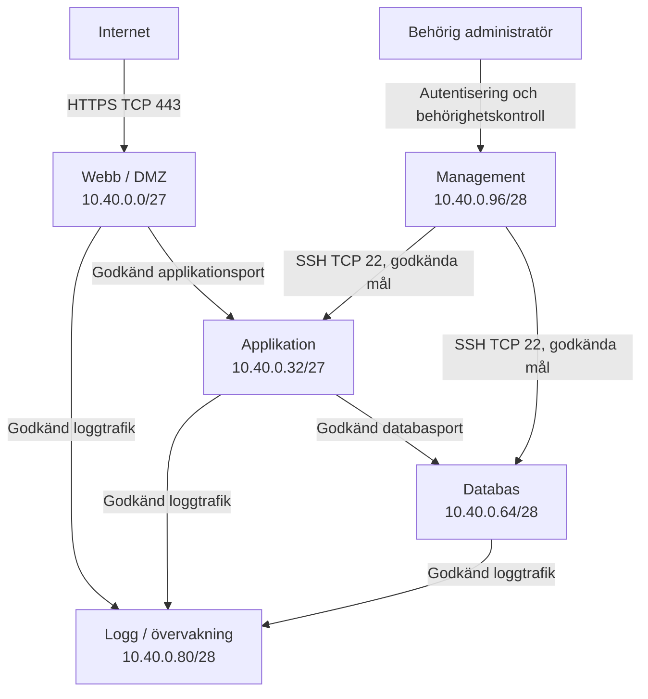

# Vecka 3 – Zero Trust och reviderad zonmodell

## 1. Syfte

Syftet med uppgiften är att granska vår befintliga zonmodell och identifiera var vi förlitar oss på implicit tillit.

Vi använder Zero Trust-principerna för att föreslå tydligare åtkomstkontroller mellan våra nätverkszoner.

**Grundprincip:** Ingen användare, enhet eller server ska automatiskt betraktas som betrodd bara för att den befinner sig i ett internt nätverk.

## 2. Vår befintliga zonmodell

Vi använder adressområdet `10.40.0.0/16` i vårt labbnätverk.

| Zon | Nätverk | Klassning |
|---|---|---|
| Webb / DMZ | `10.40.0.0/27` | Låg |
| Applikation | `10.40.0.32/27` | Medel |
| Databas | `10.40.0.64/28` | Hög |
| Logg / övervakning | `10.40.0.80/28` | Hög |
| Management | `10.40.0.96/28` | Hög |

## 3. Identifierade risker

Även om nätverket är uppdelat i olika zoner finns risker om åtkomst tillåts enbart utifrån nätverksplacering.

Exempel:

- En komprometterad webbserver kan försöka nå interna resurser.
- För breda trafikregler kan ge servrar mer åtkomst än de behöver.
- Administrativ åtkomst utan tillräcklig identitetskontroll kan missbrukas.
- Bristande loggning kan göra misstänkt trafik svår att upptäcka.

## 4. Föreslagna trafikregler

| Från | Till | Regel |
|---|---|---|
| Internet | Webb / DMZ | Tillåt TCP 443 (HTTPS) |
| Webb / DMZ | Applikation | Tillåt endast godkänd applikationsport |
| Applikation | Databas | Tillåt endast godkänd databasport |
| Godkända servrar | Logg / övervakning | Tillåt definierad loggtrafik |
| Management | Godkända servrar | Tillåt SSH (TCP 22) endast för behörig administration |
| Webb / DMZ | Databas | Blockera |
| Internet | Databas | Blockera |
| Internet | Management | Blockera |
| Övrig trafik | Övriga zoner | Blockera som standard |

De exakta applikations-, databas- och loggportarna behöver bekräftas med teamet.

## 5. Reviderad zonmodell

**Viktigt:** Pilarna visar föreslagen tillåten trafik, inte att trafiken redan är tekniskt konfigurerad. All annan trafik ska blockeras om den inte uttryckligen godkänts.

## 6. Zero Trust-checklista

Vi använder följande frågor när vi granskar zonmodellen:

1. **Resurser:** Skyddas även interna resurser, exempelvis databasen?
2. **Kommunikation:** Är kommunikationen mellan zonerna säker?
3. **Åtkomst per begäran:** Kontrolleras åtkomsten varje gång en resurs begärs?
4. **Åtkomstpolicy:** Finns tydliga regler för vilka användare och servrar som får åtkomst?
5. **Enhetssäkerhet:** Kontrolleras enheternas säkerhetsstatus innan åtkomst ges?
6. **Övervakning:** Loggas och analyseras relevant trafik?
7. **Identitet:** Kontrolleras identitet och behörighet innan åtkomst beviljas?

## 7. Hur vi minskar implicit tillit

I vår reviderade modell föreslår vi att:

- Nätverksplacering inte ensam ska ge åtkomst.
- Varje zon bara ska kunna nå de resurser den behöver.
- Åtkomst begränsas till godkända källor, destinationer och portar.
- Administrativ åtkomst kräver autentisering och behörighet.
- Trafik loggas och övervakas.
- All trafik som inte uttryckligen tillåts blockeras.

## 8. Slutsats

Vår befintliga zonmodell separerar webb, applikation, databas, loggning och management.

Med Zero Trust kan vi förbättra säkerheten genom att minska implicit tillit och införa tydligare regler för åtkomst mellan zonerna.

Den reviderade modellen bygger på principen att åtkomst ska kontrolleras och begränsas även inom det interna nätverket.

### Att bekräfta med teamet

- Exakta portnummer för applikation, databas och loggning.
- Vilka servrar som ska få kommunicera med varandra.
- Hur autentisering och behörighetskontroll ska genomföras.
- Hur trafik ska loggas och övervakas.
- Om den reviderade zonskissen behöver justeras.